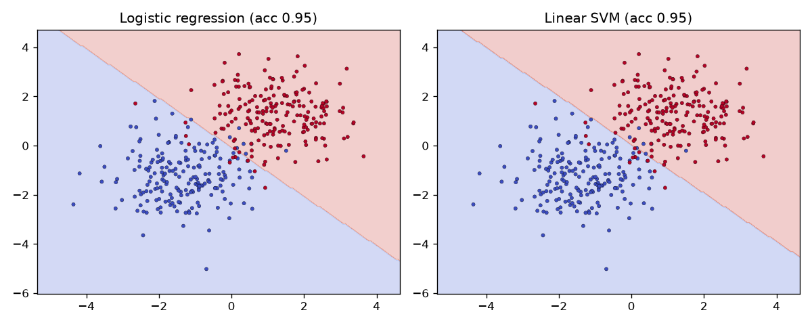
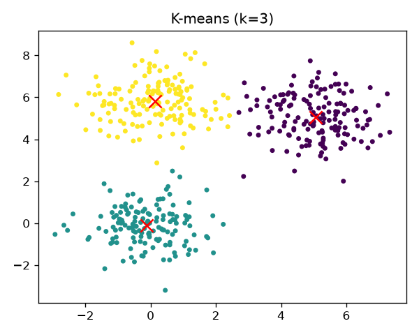
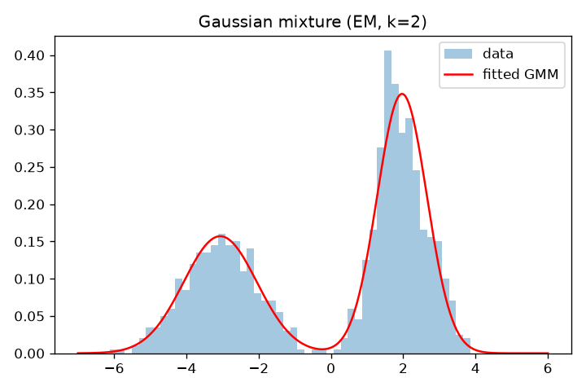

# ML Algorithms from Scratch

Clean, dependency-light implementations of four classic machine-learning algorithms using only NumPy. Each model is a small standalone class with a scikit-learn-style `fit` / `predict` interface and full docstrings, intended to show how the algorithms work under the hood.

## Algorithms

| Algorithm | Module | Class | Method |
|---|---|---|---|
| Logistic regression | `logistic_regression/` | `LogisticRegression` | Batch gradient descent on binary cross-entropy |
| Support vector machine | `svm/` | `LinearSVM` | Gradient descent on the regularized hinge loss (soft margin) |
| K-means | `kmeans/` | `KMeans` | Lloyd's algorithm with a configurable L_p distance |
| Gaussian mixture model | `gmm/` | `GaussianMixture1D` | Expectation-Maximization for a univariate mixture |

## Quick start

```bash
pip install -r requirements.txt
python examples/demo.py
```

The demo generates synthetic data with NumPy, trains every model, prints a short summary, and saves the plots below to `assets/`.

```python
import numpy as np
from logistic_regression import LogisticRegression

X = np.random.randn(200, 2)
y = (X[:, 0] + X[:, 1] > 0).astype(int)
model = LogisticRegression(learning_rate=0.1).fit(X, y)
print(model.predict(X[:5]))
```

## Results

Decision boundaries of logistic regression and the linear SVM on two Gaussian blobs (about 95% training accuracy each):



K-means with k=3 on three Gaussian clusters (red crosses mark the learned centroids):



A two-component GMM fitted with EM. The recovered parameters (weights 0.4/0.6, means -3.06/1.97, standard deviations 1.02/0.69) closely match the true ones (0.4/0.6, -3/2, 1.0/0.7):



## Authors

- Alon Hagity ([LinkedIn](https://www.linkedin.com/in/alon-hagity/))

## License

Released under the [MIT License](LICENSE).

<sub>Credits: developed with Nicole Yerushalmi · Machine Learning, Reichman University, Spring 2026.</sub>
